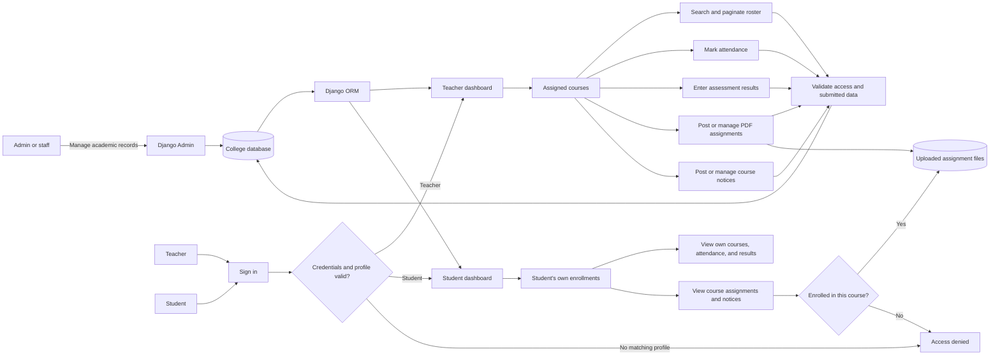

# College Management System

A Django web application for managing college academic records and role-based student and teacher workflows. The project includes departments, courses, student and teacher profiles, enrollments, attendance, assessments, results, assignments, and course notices.

The Django application is in [`college_management_system_milestone1/`](college_management_system_milestone1/).

## Features

- **Academic records:** departments, courses, student and teacher profiles, and course enrollments.
- **Role-based access:** students and teachers sign in to separate dashboards; staff can manage records through Django Admin.
- **Attendance and results:** teachers can record attendance and enter assessment results for their assigned courses.
- **Student roster:** teachers can search and paginate students in their assigned courses.
- **Assignments and notices:** teachers can post and manage course assignments and notices; students can view relevant items.
- **Protected assignment downloads:** downloads are checked against course access, and uploaded assignments are validated as PDFs.
- **Data validation:** database constraints and form/model validation help prevent duplicate or inconsistent records.

## System flow



**Flow summary:** Django authenticates each user and routes them to the dashboard for their linked role. Teachers work with courses assigned to them. Students see information connected to their own enrollments. Django validates submissions and stores records in the database; assignment downloads require course access.

## Data model at a glance

```text
Department ──< Course
Department ──< Student >── User
Department ──< Teacher >── User
Teacher >──< Course
Student ──< Enrollment >── Course
Enrollment ──< Attendance
Course ──< Assessment
Enrollment ──< Result >── Assessment
Course ──< Assignment >── Teacher
Course ──< Notice >── Teacher
```

Unique constraints protect student/course/year enrollments, attendance per enrollment/date, and results per enrollment/assessment.

## Technology

- Python
- Django 6.0.4
- SQLite for local development
- `python-dotenv` for local environment settings
- HTML and CSS templates

## Run locally on Windows

Open PowerShell at the repository root, then run:

```powershell
cd .\college_management_system_milestone1
python -m venv .venv
.\.venv\Scripts\python.exe -m pip install -r requirements.txt
```

Create a local `.env` file in the Django project folder with these settings, then replace the example secret with a randomly generated value:

```text
DJANGO_SECRET_KEY=replace-with-a-random-local-key
DJANGO_DEBUG=True
DJANGO_ALLOWED_HOSTS=127.0.0.1,localhost
```

Keep `.env` private and do not commit it. Do not commit local SQLite databases or uploaded files either.

Apply migrations, create an administrator account, and start the development server:

```powershell
.\.venv\Scripts\python.exe manage.py migrate
.\.venv\Scripts\python.exe manage.py createsuperuser
.\.venv\Scripts\python.exe manage.py runserver
```

Open <http://127.0.0.1:8000/>. Django Admin is available at <http://127.0.0.1:8000/admin/>.

## Project structure

```text
college_management_system_milestone1/
├── academics/       # Academic models, forms, validation, and migrations
├── config/          # Django settings and project URL configuration
├── core/            # Views, templates, and static styles
├── manage.py
└── requirements.txt
```

## Security and local files

For future commits, keep local secrets (`.env`), SQLite databases, uploaded media, virtual environments, and Python caches out of Git. Use a production-ready database, secure secret management, HTTPS, and production settings before deployment. The built-in Django development server is for local development only.

## Current scope

This is a learning and portfolio project that is still being developed. It covers core academic records and student/teacher workflows; production deployment, reporting, and further enhancements can be added later.